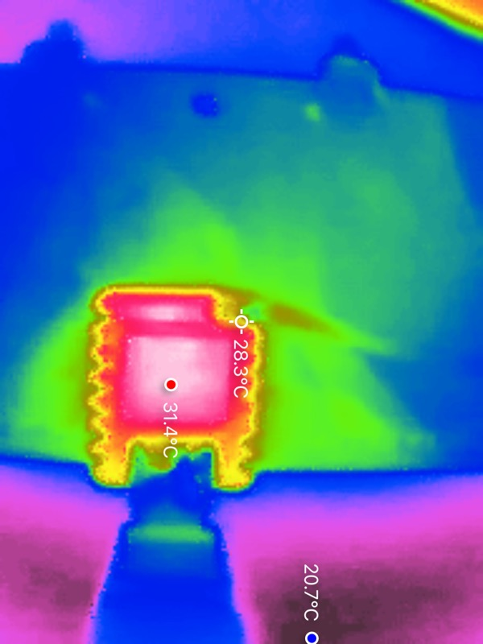

# Power: measured, 2026-09-10

Every power figure in this project was an estimate until this. Measured on the
first assembled board — the v1.1 prototype: five GC9A01 displays on an ESP32-S3
SuperMini, running the ported firmware on WiFi. The project now uses a XIAO
ESP32-S3 or XIAO ESP32-S3 Plus. **The XIAO ESP32-S3 was measured on 2026-11-16:
about 305 mA, 1.53 W, and a 770–781 mA inrush.** See
[XIAO ESP32-S3: measured](#xiao-esp32-s3-measured-2026-11-16) at the end. The
S3 Plus has not been measured. XIAO module temperature: 31.4 °C in a 20.7 °C room after ~21 min (2026-11-16).

**Instrument:** Nordic PPK II, source meter mode, 5.000 V, 10 kSa/s, 10 s window.

| | |
|---|---|
| Average | **341.79 mA** → **1.71 W** |
| Max (10 s window) | 399.87 mA → 2.00 W |
| **Boot inrush** | **1.15 A peak**, milliseconds, measured |

## What it settles

The estimate this project ran on was ~380 mA (five displays at 40–80 mA plus an
ESP32 averaging ~80 mA). Measured 342 mA, so **the estimate was 11% high** —
close enough that everything built on it stands.

**The 5 V decision is vindicated with numbers.** Upstream powers all five
displays from the module's own 3.3 V regulator. Had this load gone that way:

```
(5.0 − 3.3) × 342 mA = 581 mW in a SOT-23-5
  → junction 112–170 °C depending on copper
  → LDO thermal shutdown is 150–165 °C
```

At or past shutdown. That is what the field reports were describing — one
builder measured 82 °C **with the radio off, running only a graphics demo**.

As built, each display regulates its own 5 V and the module's LDO carries only
the ESP32: roughly 80 mA average, ~136 mW, ~52 °C estimated. The part that was
cooking is no longer in the path. Measured on 2026-10-17: **about 43 °C** at the
module's hottest point (next section).

## Boot inrush: 1.15 A, measured

**Corrected 2026-09-10.** An earlier draft recorded this as ">1 A, clipped",
assuming the PPK II source meter limited at 1 A. It does not — it read the peak
directly at **1.15 A**.

Second capture, 3 s window at 10 kSa/s covering power-on:

| | |
|---|---|
| Peak | **1.15 A**, a single narrow spike at power-on |
| Settles to | ~240 mA |
| Then steps | ~270 mA → ~300 mA as displays come up |
| Then | ~340 mA with WiFi bursts to ~450 mA |
| Window average over the 3 s | 270 mA, 0.81 C |

The staged ramp is five display regulators starting in sequence, then the radio
joining the network.

**What it means for supply choice: 1.15 A is 3.4x the running current.** A
supply sized for the 342 mA average will sag at power-on. The failure that
produces is an orb which starts on one charger and not another, with nothing
wrong with the orb — and it will be blamed on the firmware.

## Module temperature: about 43 °C, measured 2026-10-17

**Instrument:** a thermal camera, spot readings, default settings. **Board:** the
v1.1 carrier, ESP32-S3 SuperMini, five displays, Wi-Fi on and Clock, Stocks
and two weather pages cycling. **Room:** 75 °F (23.9 °C). Two sets of shots:
grayscale after hours of running, then color about 15–20 minutes after a power
cycle. The two sets agree within 1 °C, so the module reaches its working
temperature within about 20 minutes.

| Spot | Reading |
|---|---|
| Hottest point on the ESP32-S3 module, grayscale (four shots, after hours) | **41.8–42.7 °C** |
| Hottest point on the ESP32-S3 module, color (two shots, ~20 min) | **42.8–43.6 °C** |
| Background in the same frames | 23.5–25.1 °C |
| Back of a display, hottest spot | **36.3–37.9 °C** (background 24.6–24.7 °C) |


In these images white and red are hottest, blue coolest. The module runs about **19 °C over the room**.
The HackerBox 0129 builder's report was **82 °C on the same module with the
radio off**. The 52 °C computed above was an estimate; the measurement is
about 10 °C lower.

What this does and does not show:

- These are surface readings. The silicon inside the chip is hotter than its
  surface, by an amount not measured.
- The hottest point is near the middle of the module. A second, smaller hot
  spot sits toward one side of it. Which chip each one is was not identified
  from the images.
- Emissivity was left at the camera's default, so the absolute numbers carry
  that error. The comparison between spots in the same frame does not.
- The display backs reach 36–38 °C, each with a small hot spot. That fits
  each display carrying its own regulator's share of the load; which part on
  the display makes the spot was not identified.

## For pricing and supply choice

1.71 W typical, but **size the supply for the 1.15 A inrush, not the 342 mA
average**. 2 A is a sensible floor and costs nothing; 1 A is not enough despite
being nearly 3x the running current.

## XIAO ESP32-S3: measured 2026-11-16

**Board:** XIAO carrier, plain XIAO ESP32-S3 (not the Plus), five GC9A01
displays, firmware **1.8.0** (the published release), on Wi-Fi. **Feed:** PPK II
VOUT soldered to the XIAO's 5V pin, GND to GND, the XIAO's USB-C unplugged. The
SuperMini was most likely fed the same way (Scott's recollection; it was not
recorded at the time).

**Instrument:** Nordic PPK II, source meter, 5.000 V, driven from a script
(`tools/ppk/`, below) at its native **100 kSa/s**. The "10 kSa/s" figures are
means of 10 samples, to compare with the SuperMini run, which was read in
nRF Connect at 10 kSa/s. Raw log: `assets/power/xiao-2026-11-16/session.log`.
The charts page is rebuilt from the captures there by
`tools/power-report/build_report.py`.

| State (10 s window) | Average | Max (100 kSa/s) |
|---|---|---|
| **On**, ~3.5 min after the last restart (11 min after power-on), Stocks shown | **305.51 mA → 1.53 W** | 662.5 mA |
| On, 1 min after boot, Stocks hidden | 304.22 mA → 1.52 W | 635.5 mA |
| On, ~75 s after a restart, Stocks shown | 301.70 mA → 1.51 W | 675.6 mA |
| Dim, Stocks shown | 297.44 mA → 1.49 W | 452.2 mA |
| Screens off, Stocks shown | 265.48 mA → 1.33 W | 369.4 mA |

**Against the SuperMini's 341.79 mA, the XIAO orb draws about 11% less** (36 mA,
0.18 W). Which parts of the board account for the difference was not measured.

**Dim saves about 4 mA (1.4%).** That matches what the firmware does: dim
darkens the colors drawn and leaves the backlight on.

**Screens off saves about 36 mA (12%); the orb still draws 1.33 W asleep.** Off
sends display-off and sleep-in to all five panels. The likely reason it saves so
little is that the backlights stay lit, because the GC9A01 boards wire the
backlight straight to power. **That cause is not established:** nobody looked
at the screens during the off window to see whether they were fully dark.

Dim and off were set over HTTP on `/settings` (hours set to cover the current
hour), each save restarted the orb, and each window started at least 60 s after
the restart. All dim and off settings were put back afterwards; Stocks was left
on at Scott's request.

**One capture is left out of the table on purpose.** `run_06.0min.csv` (11:50:26–36,
average 319.45 mA) began about 10 s after the "screens off" save restarted the
orb, so it shows start-up, not a settled state: its 100 ms means step from
~284 to ~308 mA partway through. The capture file names count minutes from
power-on (11:44:25), not from the last restart. Corrected 2026-11-16: the
305.51 mA row was labeled "6 min after boot"; the save times put it ~3.5 min
after the last restart. All six steady captures and the four inrush captures are in
`assets/power/xiao-2026-11-16/`.

### Inrush: 770–781 mA, four power-ons

| Power-on | Peak, 100 kSa/s | Peak, 10 kSa/s | Above 500 mA |
|---|---|---|---|
| 1 | 781.1 mA | 766.0 mA | — |
| 2 (cold, 30 s off) | 773.6 mA | 765.5 mA | ~14 ms |
| 3 (cold, 30 s off) | 772.8 mA | 754.1 mA | ~11 ms |
| 4 (cold, 30 s off) | 769.5 mA | 753.9 mA | ~11 ms |

The peak is a single narrow spike at switch-on. The start-up staircase
(100 ms means) repeats every time: **~220 → ~248 → ~258 → ~276 → ~241 → ~295 →
~355 mA**. That has the same shape as the SuperMini's 240 → 270 → 300 → 340.

**The XIAO peak is about two-thirds of the SuperMini's 1.15 A.** Why was not
measured.

**Supply advice is unchanged.** A 2 A supply covers 781 mA with room to spare.
1 A would probably cope with the XIAO too, but the floor stays at 2 A: it costs
nothing, and it covers the SuperMini figure.

### A 2.07 A reading that was thrown out

The first power-on capture read **2.07 A**. It was discarded: the reader kept
only 1.3 s of the 3.5 s stream. When bytes are dropped, the PPK's 4-byte samples
lose their alignment and decode as garbage. All four complete captures agree
within 12 mA. See `TRAPS.md`, "PPK II from a script".

### Module temperature: 31.4 °C after ~20 min, 2026-11-16

**Instrument:** the same thermal camera, default settings, color. **Board:** the
XIAO orb as above, fed by the PPK on the 5V pin (the same node as USB VBUS, see
below), running firmware 1.8.0 with Stocks on. Powered on about 12:31; shots at
12:41 and 12:52.

| Spot | ~10 min (12:41) | **~21 min (12:52)** |
|---|---|---|
| Hottest point on the XIAO module (middle of the shield can) | 30.2 °C | **31.4 °C** |
| Background, same frame | 21.0 °C | 20.7 °C |
| **Rise over the room** | 9.2 °C | **10.7 °C** |



**The XIAO module settles about 11 °C over the room, against the SuperMini's
about 19 °C** (43.6 °C in a 24.5 °C frame). That fits a buck converter in place
of the SuperMini's LDO, but the cause is not established by these shots. The
room was 20.7 °C here and 23.9 °C for the SuperMini, so compare the rise over
the room, not the absolute reading. Between 10 and 21 minutes the module
gained 1.2 °C. Whether it was still climbing at 21 minutes was not measured.
The SuperMini's 20-minute and after-hours sets agreed within 1 °C.

What the images show:

- The heat is spread across the shield can, which covers the ESP32-S3 and its
  flash. **No separate hot spot marks the buck converter (U3) or its inductor
  (L4)** in either shot. At this load the converter does not stand out. Where
  U3 sits on the board was not identified.
- A warm streak leaving the module's side is most likely the PPK lead
  soldered to the 5V pin.
- The 10-minute shot is kept as `assets/thermal/xiao-module-10min-2026-11-16.jpg`.

### Not measured

- The XIAO ESP32-S3 Plus.
- Display backs on the XIAO board. They cannot be shot: the XIAO board covers
  them, whereas the v1.1 board left them in view (Scott, 2026-11-16).
- **Why the XIAO module runs cooler.** That it runs cooler is measured: about
  11 °C over the room against the SuperMini's about 19 °C (section above). The
  likely reason is the 3.3 V regulator. The XIAO's comes from a buck converter,
  U3 SGM6029 (600 mA) with a 470 nH inductor, L4. The SuperMini's is a linear
  regulator, the 43 °C concern above. A buck dropping 5 V to 3.3 V wastes far
  less. That fits the readings but is not established: no shot isolates U3,
  and the two boards differ in more than the regulator.

### Notes on the thermal shots

- **There was no XIAO thermal image before 2026-11-16.** The camera originals
  of the earlier set are timestamped 2026-10-17 16:10–16:11. That afternoon the
  XIAO board had only just been routed (commit a0c84fc, 16:08: "XIAO board
  expected in manufacturing"). So every 2026-10-17 shot shows the v1.1
  SuperMini board.
- Those SuperMini shots were most likely powered over **USB-C**. That is
  Scott's recollection, and the module frame shows a cool cable-shaped object
  leaving the module's USB edge.
- **On the XIAO the feed point makes no difference.** Per Seeed's schematic
  (`XIAO_ESP32S3_SCH_v1.2`), the header's 5V pin *is* VBUS, with no diode
  between USB-C and the pin. The diode (D2, LMBR4010) sits after that, between
  VBUS and the 3.3 V converter. So the PPK feed on the 5V pin heats the module
  exactly as USB-C would. (An earlier note here, written before reading the
  schematic, said to use USB-C. That was wrong.)
