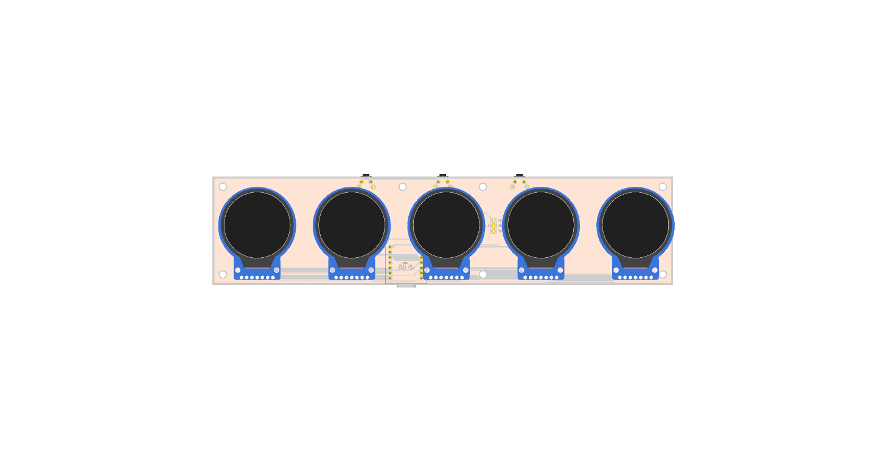
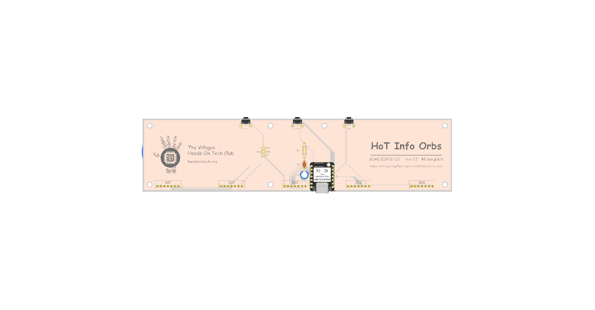

# HoT Info Orbs PCB (rev 2.5)

The carrier board: five round displays on the front, a Seeed XIAO ESP32-S3 or
S3 Plus and three buttons on the back. Every part is through-hole, and the
displays and the XIAO plug into sockets, so nothing expensive is soldered to
the board. This page is how to build one. How the board was designed, rev by
rev, is in [HISTORY.md](HISTORY.md).

| Front (displays) | Back (XIAO, buttons, C1, C2, R1) |
|---|---|
|  |  |

## Parts

Quantities, specs and buying links are in the
[BOM](bom/hot_info_orbs_xiao_46mm_bom.csv).

| Ref | Part | Face | Notes |
|---|---|---|---|
| R1 | 10 kΩ resistor, axial | back | either way round |
| C2 | 1 µF ceramic capacitor | back | either way round |
| C1 | 100 µF 16 V electrolytic capacitor | back | **polarized** |
| SW1–SW3 | right-angle 6 × 6 mm tactile switch | back | top edge, actuator pointing out past the edge |
| U2 sockets | 2 × female socket 1x7, 2.54 mm | back | inside the "XIAO GOES ON THIS SIDE" box |
| DS1–DS5 sockets | 5 × female socket 1x7, 2.54 mm | front | along the bottom edge, one under each "Display" circle |
| U2 | XIAO ESP32-S3 or S3 Plus, on two 1x7 male headers | back | plugs in; never soldered to the board |
| DS1–DS5 | 1.28" round GC9A01 display, 7-pin | front | plug in |
| TP1–TP3 | test pads 3V3 / GND / 5V | — | bare plated holes; nothing to fit |

Faces: the **front** has the white "Display" circles. The **back** has the HOT
logo, the "XIAO GOES ON THIS SIDE" box and the `rev 2.5` text. Parts on the
back are soldered from the front, and the display sockets from the back.

## Before you start

- **Check the displays' pin order.** It must read VCC, GND, SCL, SDA, DC, CS,
  RST. Socket pad 1 (the square pad) is VCC, which is +5 V. A display with a
  different order will not work here and may be damaged.
- **If your XIAO came without headers** (the S3 Plus always does), you need
  two 7-pin pieces cut from a male header strip. Seeed sells the plain S3
  with headers already soldered.
- **Check one switch against the board before you buy a lot of them.** The
  footprint is the C&K PTS645VL39; the BOM notes that the fit of the
  marketplace switches has not been checked against it.

## Assembly

Lowest parts first, so the board sits flat on the bench for each one.

1. **R1** on the back. Bend the leads to the 10.16 mm hole spacing, lay the
   body flat on the board, solder from the front and trim the leads.
2. **C2** on the back, standing up, close to the board.
3. **C1** on the back. The **long lead (+)** goes in the **squared-off pad**,
   next to the + mark on the silk; the stripe on the can marks the − lead.
   Fitted backward, it can fail on power-up.
4. **SW1–SW3** on the back, along the top edge, with the actuators pointing
   up past the edge. Solder both signal pins **and both mounting tabs**: the
   tabs take the force of each press.
5. **XIAO sockets** on the back, in the box. To keep them straight and the
   right distance apart, push the male headers into the sockets and set the
   XIAO on the headers before soldering, with its USB-C jack toward the
   bottom edge. Solder the sockets from the front. If the headers are not yet
   on the XIAO, solder them to the XIAO now, while it is held in place.
   Then lift the XIAO out.
6. **Display sockets** on the front, one under each display position. Plug a
   display into each socket to hold it square. Solder one pin from the back,
   check that the socket sits flat, then solder the other six.

**Do not solder the XIAO to the board**, even though its edge pads would
allow it. A board whose XIAO was soldered on and then removed came back
with two displays dead and a third showing the wrong picture, and was
scrapped ([docs/TRAPS.md](../../docs/TRAPS.md), 2026-11-23). Use the sockets.

## Checks before the first power-up

The test pads between the third and fourth displays are labeled on both faces.

1. **No shorts.** With nothing plugged in, use a meter on continuity between
   GND and 3V3, then GND and 5V. Neither should beep.
2. **Power with the XIAO only.** Plug in the XIAO, then USB-C. TP3 (5V)
   should read about 5 V and TP1 (3V3) about 3.3 V, both against TP2 (GND).
3. **Unplug USB, then plug in the displays,** screens facing out. Plug and
   unplug displays only with the power off.
4. Load the software: the
   [Quick start](../../README.md#quick-start-no-software-to-install-on-your-pc)
   flashes it from Chrome with nothing to install, and
   [docs/SETUP.md](../../docs/SETUP.md) builds it yourself. If a display stays dark, see
   [docs/TROUBLESHOOTING.md](../../docs/TROUBLESHOOTING.md).

The board mounts in its enclosure through the seven 3.2 mm holes. The screws
and standoffs depend on the enclosure: see
[hardware/enclosures/](../enclosures/).

## Pin map

For troubleshooting with a meter. The XIAO S3 and S3 Plus have the same map.

| XIAO pin | GPIO | Signal |
|---|---|---|
| D0 | 1 | SW1 (left) |
| D1 | 2 | SW2 (OK) |
| D2 | 3 | DS1 CS |
| D3 | 4 | DS2 CS |
| D4 | 5 | DS3 CS |
| D5 | 6 | SW3 (right) |
| D6 | 43 | DS4 CS |
| D7 | 44 | DS5 CS |
| D8 | 7 | SCLK |
| D9 | 8 | DC |
| D10 | 9 | MOSI |
| 5V | — | +5V to the displays, TP3 |
| GND | — | GND, TP2 |
| 3V3 | — | buttons, R1, TP1 |

The displays have no reset line from the XIAO: R1 and C2 reset them at
power-up. The XIAO's own LED (GPIO21) is the busy light. Why the pins are
where they are is in [HISTORY.md](HISTORY.md#pin-map-decided-2026-10-14-same-for-s3-and-s3-plus)
and [docs/VARIANT-XIAO-ESP32S3.md](../../docs/VARIANT-XIAO-ESP32S3.md).

## What is in this folder

| | |
|---|---|
| `hot_info_orbs_xiao_46mm.kicad_*` | the KiCad 10 project; symbol and footprint libraries are in `lib/`, so it opens without installing anything |
| [`bom/`](bom/) | parts list with links and prices, and the per-kit cost table |
| [`fab/`](fab/) | the Gerber zip sent to JLCPCB (30 boards, 25 Oct 2026) and the board renders; [fab/README.md](fab/README.md) says why it is never regenerated |
| [`review/`](review/) | the schematic and 1:1 board PDFs signed off before the order |
| `3d-pcb-assembly/` | STEP model of the assembled board, for enclosure design |
| [`sim/reset-rc/`](sim/reset-rc/) | simulation of the R1/C2 display reset |
| `tools/` | the scripts that made each revision; see [HISTORY.md](HISTORY.md) before running any |
| [HISTORY.md](HISTORY.md) | every revision, what was measured and what was ruled out |
| `docs/HANDOFF.md` | the step log from the first XIAO version of the board |

Changing the board: close KiCad before running any script in `tools/`, and
give a new fab run its own zip name instead of overwriting the one in `fab/`.
